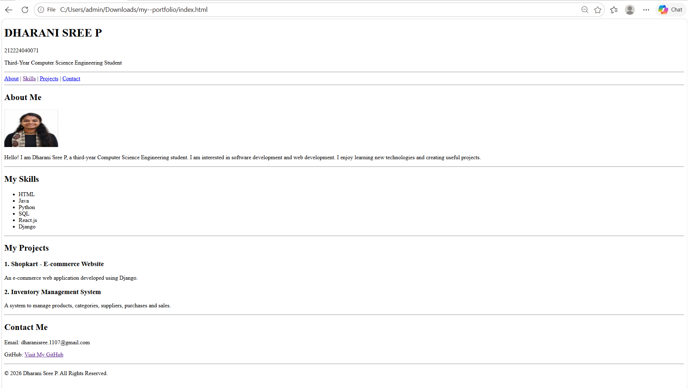

# my--portfolio

# Ex01 Portfolio
## Date:

## AIM
To create a Portfolio using HTML and CSS.

## ALGORITHM
### STEP 1
Create an HTML file (index.html)

### STEP 2
Create a CSS file (style.css)

### STEP 3
Include a navigation bar with links to different sections.

### STEP 4
Add structured sections for introduction, about, projects, and contact details.

### STEP 5
Define global styles for fonts, colors, and layout.

### STEP 6
Style the header, navigation bar, and sections.

### STEP 7
Use Flexbox or CSS Grid for layout design.

### STEP 8
Add hover effects and transitions for interactivity.

### STEP 9
Add Images and Media.

### STEP 10
Use optimized images for a professional look.

### STEP 11
Open the HTML file in a browser to check layout and functionality.

### STEP 12
Fix styling issues and refine content placement.

### STEP 13
Deploy the Portfolio.

### STEP 14
Upload to GitHub Pages for free hosting.

## PROGRAM
```
<!DOCTYPE html>
<html lang="en">
<head>
    <meta charset="UTF-8">
    <meta name="viewport" content="width=device-width, initial-scale=1.0">
    <title>My - Portfolio</title>
</head>

<body>

    <header>
        <h1>DHARANI SREE P</h1>
        <p>212224040071</p>
        <p>Third-Year Computer Science Engineering Student</p>
        <hr>
    </header>

    <nav>
        <a href="#about">About</a> |
        <a href="#skills">Skills</a> |
        <a href="#projects">Projects</a> |
        <a href="#contact">Contact</a>
    </nav>

    <hr>

    <section id="about">
        <h2>About Me</h2>

       

        <p>
            Hello! I am Dharani Sree P, a third-year Computer Science
            Engineering student. I am interested in software development
            and web development. I enjoy learning new technologies
            and creating useful projects.
        </p>
    </section>

    <hr>

    <section id="skills">
        <h2>My Skills</h2>
        <ul>
            <li>HTML</li>
            <li>Java</li>
            <li>Python</li>
            <li>SQL</li>
            <li>React.js</li>
            <li>Django</li>
        </ul>

    </section>

    <hr>

    <section id="projects">
        <h2>My Projects</h2>

        <h3>1. Shopkart - E-commerce Website</h3>
        <p>
            An e-commerce web application developed using Django.
        </p>

        <h3>2. Inventory Management System</h3>
        <p>
            A system to manage products, categories, suppliers,
            purchases and sales.
        </p>
    </section>

    <hr>

    <section id="contact">
        <h2>Contact Me</h2>

        <p>Email: dharanisree.1107@gmail.com</p>

        <p>
            GitHub:
            <a href="https://github.com/Dharani110706">
                Visit My GitHub
            </a>
        </p>
    </section>

    <hr>

    <footer>
        <p>&copy; 2026 Dharani Sree P. All Rights Reserved.</p>
    </footer>

</body>
</html>
```

## OUTPUT


## RESULT
The program for creating Portfolio using HTML and CSS is executed successfully.